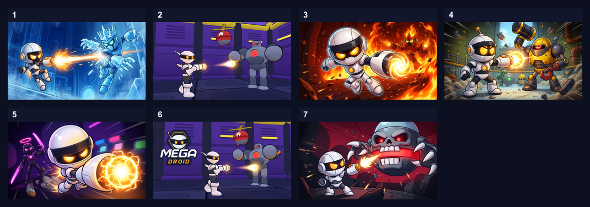
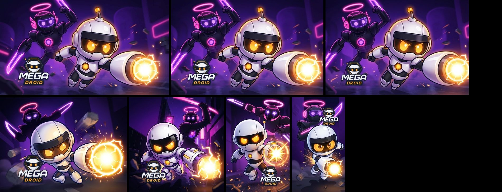

# Cover comparison (#120, 2026-10-02)

Which cover should the store pages use? Four new scenarios were staged in the
engine (the plates), painted once each by Gemini at 16:9, and scored against
the covers the game already had. The evidence behind the scoring is in
`cover-research.md`; the tool is `pnpm art:promotion` (`tools/art-promotion.mjs`).

## How it was scored

Three reviewers (independent AI reviewers, each with a different point of
view: a neutral one, a teenage player on a phone, a portal curator) scored the
seven candidates blind — numbered tiles, shuffled, at 250 px wide in a mock
portal grid, plus a 125 px and a greyscale version — on the ten criteria of
the research rubric, weighted for web portals. This is a proxy for click-through,
not a measurement: no cover was shown to real players.

| Rank | Cover | Score / 100 | Each reviewer | Picked first by |
| --- | --- | --- | --- | --- |
| 1 | **neon** — the face: Flux close, charge at the lens, the Neon Master behind (new, painted) | **79.3** | 80.6 · 79.4 · 77.8 | 2 of 3 |
| 2 | blaze — the leap out of the fire, the Blaze Master behind (new, painted) | 78.2 | 75.0 · 78.6 · 81.0 | 1 of 3 |
| 3 | vex — Dr. Vex Mk-I looming over a small Flux (new, painted) | 72.3 | 72.8 · 72.0 · 72.0 | |
| 4 | scrapper — the first painted cover | 66.9 | 67.4 · 66.8 · 66.6 | |
| 5 | frost — the duel in profile (new, painted) | 62.5 | 63.4 · 62.2 · 61.8 | |
| 6 | old store cover, not painted (in-engine render) | 53.7 | 54.2 · 48.8 · 58.2 | |
| 7 | old store cover, not painted, with the logo | 47.1 | 47.4 · 44.0 · 49.8 | last for 1 of 3 |

What decided it, per the reviewers:

- **neon** won on a single subject that reads instantly (9.0 of 10) and on the
  white hero separating from a dark violet ground (9.0). Its weak points: the
  opponent was a thin dark figure (the "fights big bosses" promise, 6.0), and
  the charge ran to the right edge.
- **blaze** had the best face (8.7) and colour, but the fire boss vanished
  into the flames and the picture was busier (simplicity 5.0).
- **vex**: the skull owns the tile, the hero is small in a corner, and it
  reads darker than an all-ages game.
- **scrapper**: too much in it (simplicity 2.7): four robots, debris, pipes.
- **frost**: blue boss on a blue ground on a navy page; the hero half white
  on pale.
- **The old renders** read as raw screenshots: a small, stiff hero, nothing
  owning the tile. The logo in the top-left made it worse.

neon and blaze are within three points. The research's tie-break (the truer
promise of the game) favours blaze by one point on that criterion, the first
clicks favour neon two to one. The answer the research gives for a tie is a
live test, not the rubric.

## What ships

**neon**, repainted once with its two weak points fixed in the prompt: the
Neon Master is a big robot boss behind Flux now, and the charge sits whole
inside the frame. (The scored image is the first painting; the shipped one was
not scored again.) The other aspect ratios were painted against that master so
every format is the same picture, recomposed, not cropped.

In `src/assets/promotion/`: eleven sizes (800x800, 1920x1080, 1080x1920,
800x1200, 1360x850, 800x450, 400x225, 512x512, 628x628, 512x384, 512x340),
each as `.jpg` and `.webp`, bare (`<w>x<h>`) and with the logo (`<w>x<h>-logo`).
The logo is laid on afterwards, never painted: lower-left on the wide and
square formats, lower-right on 2:3, upper-right on 9:16 — never top-left, where
CrazyGames lays its banner.

Which to upload where: **bare** on Poki (its own tests favour text-free) and
on Playgama (a slot may be forwarded to YouTube Playables, which forbids
branding); **with the logo** on CrazyGames and GamePix (the exact title is
allowed and encouraged) and on Steam (required).

## On "20 % click-through"

No source supports it as a target for a home-grid tile. Poki's own worked
example uses 1.5 % for action games; itch.io anecdotes run 0.3–3.5 %; YouTube
says half of everything sits at 2–10 %; named Steam data points run 0.33–9.6 %.
The realistic goal is relative: beat the category average and win a head-to-head
test. Poki's A/B test takes up to three thumbnails and judges on time played,
not clicks — **blaze** is the obvious second entry
(`pnpm art:promotion --scenario blaze` has its 16:9 master; its other formats
are not painted).
